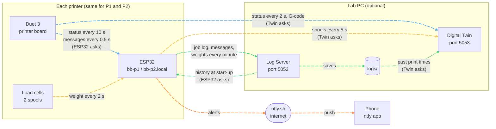

# BB_printer

Monitoring, alerting and configuration for the lab's two **BlackBelt 3D printers**
(Duet 3 MB 6HC + 3HC expansion board, RepRapFirmware 3).

| Printer | IP              | Its ESP32 (load cells + monitor) | ntfy topic |
|---------|-----------------|----------------------------------|------------|
| 1       | `192.168.1.243` | ESP32-S3, `192.168.1.132` (`bb-p1.local`) | `NTFY1` |
| 2       | `192.168.1.188` | classic ESP32, `192.168.1.226` (`bb-p2.local`) | `NTFY2` |

Each printer's ESP32 does all the monitoring by itself (alarms,
spool monitor, dashboard). No PC is needed for alerts; a PC on the same network only stores
the logs (`log_server.py`). The previous PC version (`alarm.py` + `load cel/spool_monitor.py`)
is still in the repo for reference but is not run.

| Part | What it does | Runs on |
|------|--------------|---------|
| [`load cel/hx711/`](load%20cel/hx711/) | Printer monitor + ntfy alerts + job logs, load cells, time left per spool, web dashboard | One ESP32 per printer |
| [`log_server.py`](log_server.py) | Receives the ESP32s' job logs, replies and load-cell CSVs into `logs/` | PC (optional) |
| [`twin/`](twin/) | Digital twin (read only): 3D view of the piece being printed, printed length, job %, time left and spools of both printers | PC (optional) |
| [`config.g/`](config.g/), [`macros/`](macros/) | RepRapFirmware config and macros stored on each printer's SD card (reference copies) | Duet 3 board |

```
BB_printer/
├── log_server.py            # PC log receiver for the ESP32s (stdlib only)
├── run_log_server.bat       # Windows launcher
├── twin/                    # digital twin web app for both printers (stdlib only)
├── run_twin.bat             # Windows launcher for the twin
├── alarm.py                 # previous PC printer monitor (reference, not run)
├── legacy_alarm.py          # older, larger version of alarm.py (reference only)
├── load cel/
│   ├── hx711/               # PlatformIO project: the ESP32 firmware (monitor + load cells)
│   ├── calibration.py       # serial/WiFi reader to calibrate load-cell thresholds
│   ├── spool_monitor.py     # previous PC spool monitor (reference, not run)
│   └── load_cell.png        # wiring/reference image
├── config.g/                # config.g for each printer
├── macros/                  # homing/jog macros and filament load/unload/pause/resume
└── GCODE_CHEATSHEET.md      # G/M-codes used in the config and macros
```

### How data flows

Arrows point where the data goes; "(X asks)" means X requests it, every other arrow is sent
without being asked. The Duets never start a conversation, they only answer. Moving dashes = sent regularly, dotted = occasional.
For an animated, clickable version with step-by-step stories, open
`http://<pc>:5053/flow.html` while the twin is running ([`twin/web/flow.html`](twin/web/flow.html)).



---

## 1. Printer monitor on the ESP32 (`load cel/hx711/`)

Each ESP32 watches **its own printer** (P1's ESP32 → `.243`, P2's → `.188`) through the Duet
HTTP object model (`/rr_model`) and its two load cells, and sends phone notifications through
[ntfy](https://ntfy.sh) when:

- the printer **pauses, resumes, is cancelled/stops or halts** (state transitions),
- the printer emits a **message, warning or error** (e.g. `M118` from a macro),
- a spool that is being consumed has **less than 2 h of filament left** (once per spool,
  re-armed above 2.5 h, i.e. a new spool).

| Printer | Board (PlatformIO env) | Cell 1 DOUT / SCK | Cell 2 DOUT / SCK |
|---------|------------------------|-------------------|-------------------|
| P1 (.243) | ESP32-S3-WROOM-1 (`p1`) | GPIO 17 / 18 | GPIO 15 / 16 |
| P2 (.188) | classic ESP32 (`p2`) | GPIO 21 / 22 | GPIO 18 / 19 |

### Setup

1. Copy `load cel/hx711/include/secrets.example.h` to `secrets.h` (gitignored) and fill in WiFi,
   both ntfy topics and, if you want logs on a PC, `LOG_SERVER_URL` (`http://<pc-ip>:5052`).
2. Build and upload with PlatformIO (VS Code extension or CLI), one environment per printer:

   ```bash
   cd "load cel/hx711"
   pio run -e p1 -t upload -t monitor     # P1 ESP32
   pio run -e p2 -t upload -t monitor     # P2 ESP32
   ```

3. Subscribe to both topics in the ntfy app on your phone.

### Firmware update over WiFi

With `OTA_PASS` defined in `secrets.h` (and flashed once over USB with it), later updates go
over WiFi:

```bash
pio run -e p1_ota -t upload    # P1 at 192.168.1.132; --upload-port <ip> if DHCP changed it
pio run -e p2_ota -t upload    # P2 at 192.168.1.226
```

or from the browser at `http://<esp32-ip>/update` (the "firmware" link on the dashboard) with
`.pio/build/<env>/firmware.bin`. It works while printing: monitoring stops only for the reboot,
and a running job is picked up again after it (no new "Print Started" alert). A broken or
wrong-board file is rejected and the old firmware keeps running.

The serial monitor (115200 baud) prints the IP, every 10 s the printer state, the alerts sent
and the job-log lines. The clock comes from NTP (US Eastern time), so the network needs
internet access (also needed for ntfy).

### Web pages (port 80 of either ESP32)

| URL | What |
|-----|------|
| `/` | Dashboard: both printers (state, job, layer) and, per spool, run-out time, time left, %, readings and rates. The page also asks the other ESP32 for its data. |
| `/config` | Per-cell `full` / `empty` / `ref_rate` / note (what `spools.json` used to hold) and the other ESP32's URL. Saved in the ESP32's flash. |
| `/calib` | Calibration: 100 readings per cell -> mean / std dev. A mean within 100k counts of the saved empty reel / full spool replaces it (saved to flash). |
| `/api/spools`, `/api/config`, `/data`, `/calibration` | JSON APIs |

**Time left** = `(reading − empty) / rate`. The live rate is the least-squares slope of the last
2 h of readings (shown after 10 min of data); while consuming, 15,000 counts are added to the
reading to undo the filament tension. A jump of more than 100,000 counts = spool changed, the
history restarts.

### Logs on the PC (`log_server.py`)

```bash
python log_server.py        # or run_log_server.bat; port 5052, standard library only
```

The ESP32s send to it (same files as before, in `logs/`):

- one log per print: `p1_243_<date>_<job>.log` with START, every PAUSE/RESUME, FILAMENT
  CONSUMED and END,
- printer messages: `replies_<printer-ip>.jsonl`,
- load-cell readings every 2 s: `load_cells/<p1|p2>_<date>.csv` (sent once a minute).

If the PC is off, alerts and the dashboard keep working; the ESP32 keeps the logs in RAM and
sends them later (load-cell rows: up to 2 h on P1, 1 h on P2). At boot the ESP32 reloads the
last 2 h of readings from the PC so the live rate isn't lost. Give the PC a fixed IP (DHCP
reservation) and allow Python through the Windows firewall on private networks.

### Digital twin on the PC (`twin/`)

```bash
python twin/twin_server.py   # or run_twin.bat; http://localhost:5053, standard library only
```

One page with both printers, read only (it never sends commands):

- **Piece:** when a job starts, the G-code is downloaded once from the Duet (~2 min for 30 MB)
  and its outer walls are drawn in 3D, cut by the gantry plane at the current belt position
  (orange = printed, grey = still to print). Cached in `twin/cache/`. To show the real model
  instead, put its STL in [`twin/models/`](twin/models/README.md) (named like the Cura mesh).
- **In the 3D view:** the job % (filament used / job total, like DWC) on the printed part, and
  two dimension lines on the belt: the piece's total length and the length printed so far
  (everything up to the current belt Z).
- **Job:** elapsed, time left and estimated end (Duet's filament-based estimate).
- **Spools:** the ESP32 spool monitor for both cells (from each ESP32's `/api/spools`): %, when
  the spool runs out and time left (live or reference rate), current reading, empty reel, live
  and reference rate, and Calibration / Config buttons that open that ESP32's pages. Hovering
  them shows when the cell's empty / full / reference rate last changed; the ESP32s don't keep
  that date, so the twin records it (`twin/cell_updates.json`) while it is running.

- **Data flow** (`/flow.html`, link at the top of the twin): animated diagram of who asks whom
  and how often, with step-by-step stories (print starts, pauses, spool low, ...).

Printer and ESP32 addresses are at the top of `twin/twin_server.py` (or `TWIN_P1_DUET`,
`TWIN_P1_ESP`, ... environment variables).

---

## 2. Load-cell calibration (`load cel/`)

Cells are named `p1_cell1`, `p1_cell2` (printer 1, .243) and `p2_cell1`, `p2_cell2` (printer 2,
.188); each printer has its own ESP32, whose `cell1`/`cell2` are that printer's cells. Values
are raw HX711 counts (no tare); the reading goes up with weight. A 4 kg spool is ~1565 m
(measured on `p1_cell1` and `p2_cell1`, see `load cel/calibration_results.txt`).

| Cell       | counts/m | Empty reel | Source |
|------------|----------|------------|--------|
| `p1_cell1` | ~538     | 932,225    | slope from print drop (13,100 counts/h); empty reel 2026-10-24 |
| `p1_cell2` | pending  | 88,770     | empty reel 2026-10-23/24; slope = (full spool − 88,770) / 1565 |
| `p2_cell1` | ~530     | pending    | fitted against a P2 print's extrusion CSV (P2 classic ESP32) |
| `p2_cell2` | ~636     | −314,500   | fitted against a P2 print CSV; full spool +542,900 (P2 classic ESP32) |

To measure a reference, put the spool (or empty reel) on the cell and either open `/calib`
on the ESP32, or run `calibration.py` (below). The ESP32
calibration (~200 s, spool at rest, not printing) updates the cell's `empty` or `full` by itself
when the mean is within 100k counts of the saved value, and keeps it in flash (NVS) across
reboots and reflashes; `config.h` only holds the starting values. A value further off (e.g. the
estimated `full` of `p1_cell2`) has to be set once at `/config`.

```bash
python "load cel/calibration.py"                  # both printers (P1 and P2) over WiFi
python "load cel/calibration.py" p1               # only P1 over WiFi
python "load cel/calibration.py" p1=COM3 p2       # P1 over serial (your ESP32's port), P2 over WiFi
python "load cel/calibration.py" p2=192.168.1.50  # P2 from another IP (printed on serial at boot)
```

Over WiFi it polls `http://<esp32-ip>/data` (`{"seq":..,"ok":true,"cell1":..,"cell2":..}`). It
prints the mean and standard deviation of every 100 readings per cell. Then enter the new
`full` / `empty` / `ref_rate` on the ESP32's `/config` page.

---

## 3. Printer firmware files (`config.g/`, `macros/`)

Reference copies of what lives on each printer's SD card — edit here, then upload through
Duet Web Control.

- `config.g/<ip>_config.g` — machine configuration (drives, steps/mm, speeds, currents,
  heaters, sensors) for each printer.
- `macros/macros_<ip>/` — homing (`homeall.g`, `homex.g`, …) and jog macros (`x+10.g`, …).
- `macros/load/<188|243>/` — filament load/unload and `pause.g` / `resume.g` for each printer.

See [`GCODE_CHEATSHEET.md`](GCODE_CHEATSHEET.md) for an explanation of the G/M-codes used.

---

## References

- [Duet3D RepRapFirmware Object Model](https://github.com/Duet3D/RepRapFirmware/wiki/Object-Model-Documentation)
- [RepRapFirmware G-code reference](https://docs.duet3d.com/User_manual/Reference/Gcodes)
- [ntfy documentation](https://docs.ntfy.sh)
- [bogde/HX711 library](https://github.com/bogde/HX711)
